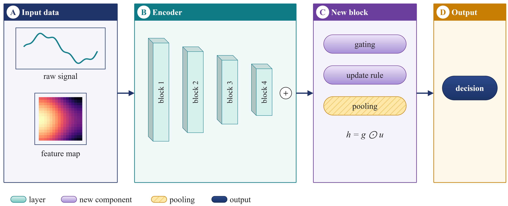

# naqid (ناقد)

**A Claude skill that attacks your manuscript before reviewers do.**

By **Dr. Mohammed Tawfik** · [kmkholm.github.io](https://kmkholm.github.io/) · kmkhol01@gmail.com · ORCID [0009-0004-7622-5991](https://orcid.org/0009-0004-7622-5991)

Most people ask an AI assistant to write for them. naqid asks it to find where you are wrong.
You write the argument; the skill tries to break it in several rounds, checks every
important citation against what the cited paper actually reports, and gives you a dated
record of each attack and how the text was rebuilt.

## What it does

| Mode | Say | Result |
|---|---|---|
| Critique (default) | `naqid`, "critique my paper", انقد الورقة | `CRITIQUE.md` next to the manuscript |
| Quick | "quick critique" | rounds 1, 3, 4 without database searches |
| References | "check my references", افحص المراجع | reference audit and citation fidelity |
| Figures | "check the figures" | figure, table and layout attack |
| Viva | "viva / defence" | 25 likely examiner questions with where the answer lives |
| Re-run | "again after revision" | status of every earlier finding plus new ones |
| Write | "write the introduction", اكتب القسم | write, attack, rebuild, section by section |
| Draw | "make Figure 1 in draw.io", شكل المنهجية | editable draw.io method figure plus the results figure set |
| Title | "suggest a title / model name", اقترح عنوان | formal titles checked for duplicates and name collisions |

### The critique rounds

1. **Hostile examiner.** The three weakest points and where an examiner would attack:
   claims wider than the evidence, numbers that disagree between abstract and tables,
   missing seeds or confidence intervals, unfair baselines, leakage, ablations that do not
   isolate the credited component.
2. **Sources.** Every reference is checked for existence, DOI/title match, preprint status
   and retraction or correction notices. The 5-10 citations the argument rests on are
   compared with the cited paper's abstract or full text and labelled supported, overstated,
   misattributed, contradicted, shallow or unverifiable. Every "first" or "novel" claim is
   searched for prior art.
3. **Hidden assumptions.** What the conclusions take for granted, the strongest objection
   to the main result, alternative explanations not ruled out, and the one-sentence
   conclusion the evidence actually supports.
4. **Editor's view.** Likely decision at the target venue and an ordered rebuild plan.
5. **Figures and layout.** Printed font sizes, label length, names that drift between
   figure and text, missing results figures, float order.

The critique never rewrites your paper. Each finding is anchored to a line and a quote
from the manuscript, and every statement about a source carries a DOI retrieved in that run.

### Where the searches go

If a signed-in **Scopus** tab is open in the browser Claude controls, the skill uses it
(through your own session, about one request every three seconds, DOIs batched 25 per
query). If not, it falls back to **OpenAlex**, **Crossref**, Consensus, PubMed and web
search without stopping. Checks made only on the open web are marked
`Scopus: not checked`. The skill never types credentials.

## Scripts

All in `naqid/scripts/`, Python 3.9+.

| Script | Purpose |
|---|---|
| `naqid_extract.py` | references, citing sentences, candidate claims; `--check` adds Crossref DOI/title checks and retraction notices (.tex, .bib, .docx, .md) |
| `naqid_style.py` | register scan: colon punchlines, em dashes, "not X but Y", stock AI vocabulary, short dramatic sentences, body bullet lists; LaTeX checks for "Fig.", rotated floats, unreferenced floats and float order |
| `naqid_titlecheck.py` | closest published titles, model-name collisions and topic density through OpenAlex and Crossref |
| `naqid_figcheck.py` | draw.io figure check: printed font size at text width (from the exported PDF), label length, font family, embedded data images |
| `drawlib.py` | small library that writes editable draw.io method figures: lettered panels, pills, 3-D slabs, operator circles, real-data thumbnails, flow arrows, legend |
| `example_fig1.py` | template generator for a method Figure 1 |

```bash
python naqid/scripts/naqid_extract.py paper.tex --check
python naqid/scripts/naqid_style.py paper.tex
python naqid/scripts/naqid_titlecheck.py --title "Your candidate title" --name MyNet --terms "term one" "term two"
python naqid/scripts/example_fig1.py out/
python naqid/scripts/naqid_figcheck.py out/Figure1.drawio --textwidth 483
```



## Install

**Claude Code (CLI or desktop app).** Copy the `naqid` folder into your skills folder:

```bash
git clone https://github.com/kmkholm/naqid.git
```

```bash
cp -r naqid/naqid ~/.claude/skills/
```

On Windows the folder is `%USERPROFILE%\.claude\skills\`. Start a new session; type
`/naqid` or just ask for a critique.

**claude.ai.** Download `naqid.skill` from the
[latest release](https://github.com/kmkholm/naqid/releases/latest) and upload it under
Settings → Customize → Skills. The scripts need code execution to run there; the
database checks need the Scopus or web tools available in your session.

**Optional dependencies.** `pip install -r requirements.txt` (numpy, Pillow, matplotlib,
PyMuPDF). draw.io desktop exports figures to PNG/PDF; set `DRAWIO_EXE` if it is not found
automatically.

## Notes

- Scopus access is your own subscription; the skill only reads search results and
  abstracts the way the Scopus web page does, at a slow rate.
- Retraction checks rely on notices registered with Crossref.
- OpenAlex and Crossref show that a work exists, not that Scopus indexes it.

## License

MIT. See [LICENSE](LICENSE).

## Citation

If the skill helps your work, please cite it with the metadata in [CITATION.cff](CITATION.cff).
